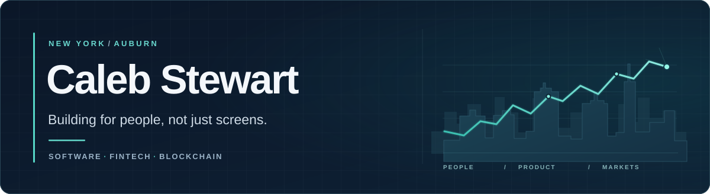

  

   

  **Computer Science @ Auburn University** &nbsp;·&nbsp; **New York → Auburn**

   

  &nbsp;
  

 

## Hey, I'm Caleb

I'm a computer science student at **Auburn University**, originally from **New York**. I like being at the intersection of **software, people, and business**.

I genuinely enjoy the technical side of engineering, but I'm just as interested in the conversations behind it: **who has the problem, why it matters, and how to build something that actually helps**. Working on production software has shown me how much good engineering depends on understanding people and collaborating well.

Lately, I'm especially drawn to **financial technology, blockchain, and AI** — and how they can make complex systems more useful and accessible in the real world.

## The intersection I'm interested in

| People & products | Technology & markets |
| :--- | :--- |
| Understanding users, communicating ideas, and building things that solve real problems. | Exploring fintech, blockchain infrastructure, financial markets, and thoughtful applications of AI. |

## Experience in the real world

**UDA Technologies** &nbsp;·&nbsp; *Software Engineering Co-op*  
Worked on **ConstructionOnline**, shipping customer-facing features, fixes, and improvements to production. One highlight was building a meeting action-item workflow designed to make a common task significantly faster.

**Kasisto AI** &nbsp;·&nbsp; *Software Engineering Intern*  
Worked with cross-functional teams on production AI products, improving frontend experiences, building data visualizations, and contributing to AI configuration tooling.

## What I'm building

**Market Outlook Portfolio** &nbsp; `In progress`  
A personal project exploring a better way to bring together portfolio tracking, market data, and AI-supported research. The goal is to make it easier to understand the story behind a market move — not just the numbers.

`React` · `TypeScript` · `Python` · `FastAPI` · `PostgreSQL` · `Gemini`

<!-- When the project is public, add a repository/demo URL here. No placeholder link is shown to visitors. -->

## Tools I work with

  

Also: SQL · REST APIs · GitLab · LangGraph · .NET WebForms

## Away from the keyboard

You'll usually find me **following markets, lifting, DJing, or meeting people with different interests and backgrounds**. I like learning how businesses and industries work, and I think those conversations make me better at building software for the people who use it.

---

  Interested in software, markets, or building something useful? <a href="https://www.linkedin.com/in/caleb-stewart06/">Let's connect →</a>

